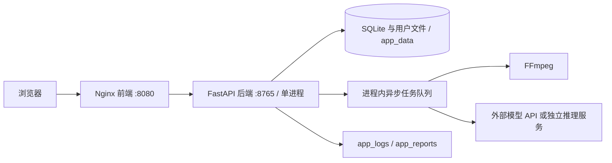

# AI 视频自动化工厂

将 Word 剧本、人物和产品参考素材组织成可审核的视频生产流程：解析剧本、准备角色与场景、生成关键画面和视频、处理声音与画质，再合成 MP4。网页与后台由 Docker 运行，生成模型由你在设置页配置。

> 源码、`latest` 与固定提交镜像已公开，两轮发布工作流、两架构匿名拉取和正式镜像的本机空卷首次启动均已验证。各环境与模型范围见 [发布验收记录](docs/RELEASE_VALIDATION.md)；正式版本请对照 [Tags](https://github.com/willzhang35929924-ui/AI_Video_Creation/tags)、[Releases](https://github.com/willzhang35929924-ui/AI_Video_Creation/releases) 及关联 Actions 的实际结果。

## 普通用户安装

1. 安装并启动 [Docker Desktop for Windows](https://docs.docker.com/desktop/setup/install/windows-install/) 或 [Docker Desktop for Mac](https://docs.docker.com/desktop/setup/install/mac-install/)。Windows 选择 WSL 2 / Linux 容器；Mac 安装与你的芯片对应的版本。
2. 从 [项目仓库](https://github.com/willzhang35929924-ui/AI_Video_Creation) 点击 **Code → Download ZIP**，解压后进入包含 `compose.yaml` 的文件夹。也可运行 `git clone https://github.com/willzhang35929924-ui/AI_Video_Creation video-factory`。
3. 在这个文件夹打开 PowerShell 或终端，执行：

   ```bash
   docker compose up -d
   ```

4. 打开 [http://127.0.0.1:8080](http://127.0.0.1:8080)，进入**系统设置 → 服务档案**，配置需要的模型服务并测试连接，然后在项目工作台导入 Word。

生产部署会拉取已发布镜像；不需要在宿主机安装 Python、Node.js、数据库或 FFmpeg。默认值已经可以启动网页，**无需先创建 `.env` 或填写 API Key 才能启动**。模型推理需要你自己的服务、权限和额度，不随应用附送。初次下载镜像需要网络与磁盘空间。

详细步骤：[Windows 安装](docs/INSTALL_WINDOWS.md)、[macOS 安装](docs/INSTALL_MACOS.md)、[完整使用教程](docs/USER_GUIDE_ZH.md)。

## 能做什么

- 生成、审核、导出 Word 剧本，或导入完整 Word 模板并检查解析结果。
- 管理人物素材、声音参考、固定产品与道具图；项目中的人物图和产品图均可按需添加。
- 配置语言、图像、视频、语音、画质等用途的服务档案，并按已实现的协议连接本地或云端服务。
- 自动编排镜头任务，记录任务与生成版本；生成失败时提供原因与重试入口。
- 审核关键画面和视频、提交修改、编辑完整提示词；合成工作台选择已批准的视频版本输出 MP4。
- 使用镜像内的 FFmpeg 做媒体探测与合成。ComfyUI、H3、CosyVoice、IndexTTS、SeedVR2 等保留对应功能与连接边界，**模型权重和 GPU 运行环境不在通用镜像里**。

## 平台与模型边界

| 环境 | 应用部署路线 | 模型生成路线 |
| --- | --- | --- |
| Windows x86-64 | Docker Desktop，Linux AMD64 镜像 | 云端 API；或已独立部署且容器可访问的受控服务 |
| Mac Apple Silicon | Docker Desktop，Linux ARM64 镜像 | 优先云端 API；可兼容的原生宿主机服务必须另行验证 |
| Mac Intel | Docker Desktop，Linux AMD64 镜像 | 同上；不能把 Windows CUDA 运行环境搬入 Mac 容器 |

多架构构建与 Mac 实机验收分别记录。**当前 Mac 实机测试为 BLOCKED，未取得 Mac 设备验证**；不能据此承诺所有 Mac 上的模型推理和视频生成已经验证通过。实际构建、发布和业务测试状态见发布验收记录：[发布验收记录](docs/RELEASE_VALIDATION.md)。

Windows 原生 H3 生视频，以及 SeedVR2 的 720p 横屏和 1080p 竖屏目标处理已有验证；容器业务、最终发布镜像和其余服务组合的验证范围以逐项验收记录为准。普通容器不自动下载或启动 NVIDIA/CUDA 模型，也不会为 Apple GPU 提供 CUDA。原生 Windows 的结果不能作为 Linux 容器或 Mac 推理验证。模型显存、许可证与硬件要求以所选模型的官方说明为准。

## 服务依赖与数据



实际只有 `frontend`、`backend` 两个 Compose 服务；没有 Redis、Celery 或 PostgreSQL。不要增加 Uvicorn worker 数量或启动多份后端共享同一数据卷。详细说明见 [架构文档](docs/ARCHITECTURE.md)。

三个命名卷保存业务数据、日志与报告：`app_data`、`app_logs`、`app_reports`。实际卷名由 Compose 项目名加前缀。数据库、上传素材、剧本、工作流、角色参考、生成结果和加密主密钥位于 `app_data`。容器重建不清空数据卷；改用另一个项目名会创建另一套卷。

首次启动自动迁移并建立空白业务库；不会导入维护者的历史项目、素材、密钥或模型档案。升级会执行版本化迁移，旧 SQLite 在迁移前会生成结构升级备份；这不代替你自己的完整离机备份。

## 日常操作

```bash
# 状态和最近日志
docker compose ps
docker compose logs --tail=100 backend frontend

# 配置、数据目录等启动诊断；不会执行付费推理
docker compose exec backend python -m app.container_entrypoint doctor

# 更新：拉取远程镜像并按需重建，保留数据卷
docker compose up -d

# 暂停与再次启动
docker compose stop
docker compose up -d

# 移除应用容器和项目网络，保留业务数据卷
docker compose down
```

后台健康信息：[http://127.0.0.1:8080/api/health/runtime](http://127.0.0.1:8080/api/health/runtime)。`application_ready: true` 表示基础应用已就绪；外部模型缺失可能显示 `degraded`。健康检查不会替你做模型生成验收。

**升级前先备份。** Windows 运行 `./scripts/backup-docker.ps1`，Mac 运行 `bash ./scripts/backup-docker.sh`。保管脚本输出的归档和校验信息；归档包含数据库、媒体和解密服务配置所需的主密钥，是私人数据。恢复到全新空数据卷，具体命令见 [备份、恢复与发布教程](docs/DOCKER_RELEASE_GUIDE_ZH.md)。

不要在更新、迁移或普通卸载时使用 `docker compose down -v`：它会删除命名数据卷。不要为了排错删除主密钥、数据库或执行全盘 Docker 清理。

## 配置外部服务

在设置页按用途选择服务、协议、地址和模型，输入自己的凭据并测试；密钥通过后端加密保存。`.env.example` 只提供端口及受控本地服务等可选部署配置，不能写入真实密钥后提交。

容器里的 `localhost` 指向容器自身。连接 Docker Desktop 宿主机服务时通常使用 `host.docker.internal`，例如 `http://host.docker.internal:8189`，并配置精确的本地服务 origin 白名单。只绑定宿主机 `127.0.0.1` 的服务未必能通过该地址访问，需按实际监听、防火墙和访问权限验证。远程 Mac mini 或 GPU 主机使用可达的受控地址。详见 [使用教程](docs/USER_GUIDE_ZH.md)。

能列出模型不表示视频接口可用；语言模型也不因为配置在视频用途就能返回视频。更换中转供应商时，必须确认应用已支持它的提交、查询和结果协议。
