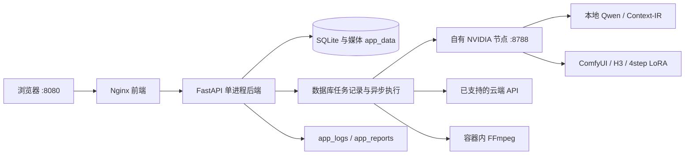

# AI 视频自动化工厂

把 Word 剧本、人物与产品参考、分镜生成、人工审核和 MP4 合成放在同一条生产流程中。Windows 和 Mac 用 Docker Desktop 运行网页与后台；本地模型由用户在自己的推理主机单独安装，在**系统设置 → 服务档案**填写接口。

本次源码包含 Context-IR 全链路和 Fast 4 / Quality 20 / Quality 30 三档工作流。默认命令会构建**当前下载的源码**，避免旧 GHCR 镜像缺少这些功能。模型、CUDA 环境、私人数据和 API Key 均不随项目提供。

## 1. 下载后启动网页

安装并启动 [Docker Desktop for Windows](https://docs.docker.com/desktop/setup/install/windows-install/) 或 [Docker Desktop for Mac](https://docs.docker.com/desktop/setup/install/mac-install/)。Windows 使用 WSL 2 后端及 Linux 容器；Mac 选择对应芯片版本。

从本仓库 **Code → Download ZIP** 解压，进入包含 `compose.yaml` 的目录。也可用 Git：

```bash
git clone https://github.com/willzhang35929924-ui/AI_Video_Creation.git video-factory
cd video-factory
docker compose up -d
```

等待首次构建与健康检查完成，打开 **[http://127.0.0.1:8080](http://127.0.0.1:8080)**。无需先创建 `.env`，应用主机也无需安装 Python、Node.js、SQLite 或 FFmpeg。构建需要联网获取 Docker 基础镜像、锁定依赖和 Debian 软件包；后续构建会利用缓存。

`compose.yaml` 使用 [Compose 官方支持的 `pull_policy: build`](https://docs.docker.com/reference/compose-file/services/#pull_policy)，所以这条命令会构建本地源码，无需额外输入 `--build`。数据保存在命名卷中，不会因重建镜像而清空。

详细安装：[Windows](docs/INSTALL_WINDOWS.md) · [macOS](docs/INSTALL_MACOS.md) · [故障排查](docs/TROUBLESHOOTING_ZH.md)。

## 2. 单独安装模型与推理节点

网页容器与 GPU 推理节点分开部署：

| 使用方式 | 应用运行位置 | 模型运行位置 |
| --- | --- | --- |
| Windows NVIDIA 本机 | Docker Desktop | 同机独立的 ComfyUI、Qwen、H3 与节点运行环境 |
| Mac 连接本地 H3 三档 | Docker Desktop | 用户自己的 Windows NVIDIA 推理主机，通过受控局域网连接；Linux 原生节点待验收 |
| 云端 API | Windows 或 Mac 的 Docker Desktop | 所选供应商；必须使用本项目已经实现的接口协议 |

**先按 [本地推理节点部署教程](docs/local-inference.md) 安装模型、依赖和项目节点，再做接口配置。** 仓库提供 `scripts/local_inference/` 的部署工具、`runtime-manifests/` 的来源校验清单，以及 `workflows/` 的工作流；不自动重新下载已有权重，不把模型打入普通应用容器。

Context-IR 节点入口默认端口为 **8788**，内部协调 ComfyUI 与本地视觉语言服务。只运行普通 ComfyUI 的 8188/8189 端口，或仅能访问 `/v1/models`，都不足以说明 Context-IR 已部署完成。需要对应节点、模型、受支持的运行版本和真实图像理解能力。

Mac 的 Docker 网页与 NVIDIA 推理是两件事。此项目不把 Windows CUDA 环境转换为 Metal/MPS，也未完成 Mac 物理设备或 Linux GPU 节点的生成实测。实际范围以[验收记录](docs/RELEASE_VALIDATION.md)为准。

## 3. 在设置页连接自己的服务

在 **系统设置 → 添加服务** 中按用途保存服务档案。配置本地 H3 三档视频：

1. 服务用途选 **视频生成**，提供商选 **本地 / 私有 ComfyUI**。
2. 内置视频工作流选 **Context-IR 三档：Fast 4 / Quality 20 / Quality 30**。
3. 同一台 Docker Desktop 宿主机填 `http://host.docker.internal:8788`；另一台自有 GPU 主机填实际受控地址，例如 `http://192.168.1.20:8788`。
4. 勾选 **确认这是我管理的本地模型服务**，保存后点 **测试连接**，根据实际诊断补齐模型或节点。
5. 在项目的视频服务选择处采用这个档案，保存项目配置。

这条路径无需修改 `.env`。本地信任只用于该档案的精确服务地址，不会放开任意文件导入或媒体 URL。容器内的 `localhost` 指向容器自身；远程服务还需正确监听并允许受控网络访问。HTTP 只用于明确确认的本地/私有推理服务，云端地址仍需 HTTPS。

其他用途也要按实际适配器配置和测试。图像、语言、视频接口不是同一种协议；本机语音/口型的 CLI 适配器不能凭一个任意 HTTP 地址变成远程服务。密钥只在设置页输入并加密保存。更多说明见[完整使用教程](docs/USER_GUIDE_ZH.md)。

## 4. 选择三档与参考素材

在**系统设置的制作画质**或**项目的制作画质**中选择并保存：

| 网页选项 | 实际工作流 | 采样步骤 |
| --- | --- | --- |
| Fast | `H3_R2V_OpenH3IR_SMD4_Fast`，加载对应 4step LoRA 与固定采样配方 | 4 |
| 标准 | `H3_R2V_OpenH3IR_Quality` | 20 |
| 高质量 | `H3_R2V_OpenH3IR_Quality` | 30 |

三档都启用 Context-IR：读取上传的图片、文字和参考视频，编译镜头要求后交给 H3。参考视频默认提供动作/摄影结构；人物和产品身份仍由明确绑定的图片与剧本要求确定。四步方案需要实际 LoRA 和节点支持，不能只把步数改成 4。

新任务冻结工作流、采样步骤、素材哈希和模型服务快照；改档不会替换已经提交的任务。可在视频任务的**提示词、参考与复现快照**查看实际执行配置。后期超分、生成原始尺寸与最终合成尺寸分别设置；选择 4K 不代表模型原生生成 4K。

## 5. 下载 Word 模板并完成第一条视频

当前空白模板：**[剧本模板.docx](docs/templates/剧本模板.docx)**。也可以在**项目工作台 → Word 导入 → 下载 Word 模板**获取同一文件；[完整示例](docs/templates/剧本导入示例.docx)保留供字段对照。

1. 保留模板标题、表格字段与列名，填写项目、人物、场景、道具、分镜、摄影、对白和声音策略。固定产品名称要与图库一致。
2. 导入 Word，先核对人物、镜头、时长、画幅、说话人和解析歧义。
3. 按需要添加人物参考、声音参考，以及人物参考下方的**固定产品／道具图**。人物和产品参考均可选；需要保持外观时再配置。
4. 选择视频服务与三档画质并保存，从程序点击开始制作。等待真实服务返回；遇到问题先按错误修复，保留已接受的任务 ID。
5. 实际播放并审核素材和分镜；在合成工作台选择已批准版本，渲染最终 MP4，下载检查画面、声音与时长。

先用一条短镜头验收，再扩展整集。容器健康、连接成功和进度完成都不等于画面或成片已通过人工审核。操作细节见 [Word 到 MP4 教程](docs/USER_GUIDE_ZH.md)。

主导航按 **项目工作台 → 剧本生成 → 脚本与分镜 → 成片审核 → 合成成片 → 系统设置** 排列。分镜、审核和合成入口保持当前所选项目；旧“审片与成片”“视频制作”地址兼容跳转到对应页面。

对白比镜头长时，在 **项目工作台 → 需要处理的异常** 选择 **延长镜头／缩短台词／调整语速**，预览后确认。程序只重新处理受影响的镜头节点，保留原片、原配音和历史版本；完成后重新审核新结果。操作和适配器限制见 [对白超长处理](docs/对白超长处理.md)。

审核页修改画面后，适用的原独立配音与画质处理会自动续接；更新前留下的原始修订可使用“恢复此修订的配音与画质”。产品尺寸约束进入最终 Context-IR 镜头正文，混杂产品参考会先检查再采样。更新应用时也要更新推理主机上的项目自有节点，见[视频修订与配音恢复](docs/视频修订与配音恢复.md)。

## 6. 服务、数据与日常维护



Compose 只有前端、后端两个服务；SQLite 与任务队列不依赖另装 PostgreSQL 或 Redis。后端保持单进程，不要同时启动多份后端共享同一套数据卷。首次启动自动迁移并建立空白业务库；不带维护者的历史记录、素材、密钥或模型。

`app_data` 保存数据库、用户素材、生成结果和 `/app/data/.secrets/master.key`；`app_logs`、`app_reports` 保存日志和报告。实际卷名前缀为 Compose 项目名，默认 `video-factory`。换项目名会连接另一套数据；只复制源码文件夹不能备份这些卷。

```bash
docker compose ps
docker compose logs --tail=100 backend frontend
docker compose exec backend python -m app.container_entrypoint doctor
docker compose stop
docker compose start
```

升级前先备份：Windows `./scripts/backup-docker.ps1`，Mac `bash ./scripts/backup-docker.sh`。随后更新源码，再运行 `docker compose up -d` 重新构建。备份包含私人数据库、文件与解密主密钥，应离机保存。恢复必须使用匹配的完整归档；参见[备份与恢复](docs/DOCKER_RELEASE_GUIDE_ZH.md)。不要在普通更新中运行 `docker compose down -v`。

基础健康接口：[运行状态](http://127.0.0.1:8080/api/health/runtime)。`application_ready: true` 表示网页基础应用就绪；外部模型未配置时可显示 `degraded`，仍需另外做真实生成测试。

## 其他部署方式

- **预构建发行镜像：** `docker compose -f compose.prebuilt.yaml up -d`。它使用 GHCR 已发布镜像，可能早于当前源码，**不能假定已经包含本次 Context-IR 更新**。先核对版本与[发布记录](docs/RELEASE_VALIDATION.md)，不要把旧镜像直接降级到新版数据库。
- **独立开发环境：** `docker compose -f compose.dev.yaml up -d --build`，默认项目 `video-factory-dev`、端口 `18083`，避免与正式业务卷混用。
- **可选部署参数：** `.env.example` 可调整端口、镜像源及管理员默认地址；普通设置页服务配置无需编辑它，不在文件中填写真实 API Key。

模型许可证、显存与运行框架限制由用户按模型官方说明核对。项目自有代码许可证见 [LICENSE](LICENSE)，第三方内容见 [THIRD_PARTY_NOTICES.md](THIRD_PARTY_NOTICES.md)。
