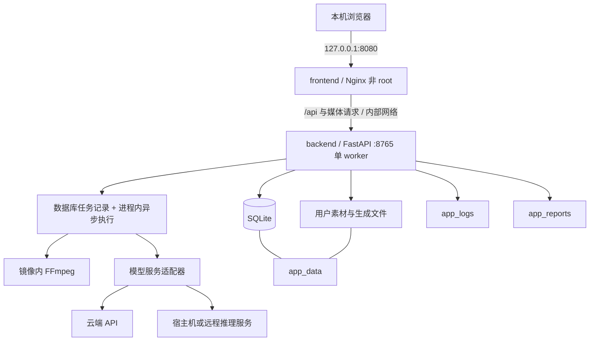

# 实际架构与部署边界

## 应用结构

```text
backend/                 FastAPI、领域服务、适配器、任务执行与 Alembic 迁移
frontend/                React / TypeScript / Vite 网页
schemas/                 剧本等结构化输入规范
workflows/               应用支持的工作流定义，不包含模型权重
docs/templates/          可公开的 Word 空模板与示例
tests/                   自动化验证与明确的测试 fixtures
scripts/                 启动、部署、备份与维护工具
.github/workflows/       代码检查与镜像构建发布
compose.yaml             用户生产部署：拉取已发布镜像
compose.dev.yaml         开发部署：由当前源码构建
```

具体文件以当前提交为准；不把用户数据库、历史素材或本地模型目录当作源码。容器前端由 Node 构建，最终只运行 Nginx；后端镜像含 Python、应用依赖、FFmpeg 和必要字体。

## 两个服务



没有单独的数据库或 Redis 容器。SQLite 保留任务状态，后端进程中的异步 worker 执行任务。当前应用建立 11 类异步执行循环，**不是 11 个 Uvicorn 进程**。GPU 互斥、编排状态与执行生命周期存在进程内约束，因此后端必须保持单进程、`--workers 1`；不得用横向扩容或多 worker 方式共享同一个库和数据卷。

默认仅前端映射宿主机端口，后端通过 Compose 内部网络访问。前端代理 API 和媒体请求，使浏览器使用同源地址，不把 API Key 打包到前端。

## 数据、迁移与凭据

| 卷 | 内容 | 生命周期 |
| --- | --- | --- |
| `app_data` | SQLite、上传素材、剧本与工作流副本、人物/产品/声音参考、生成结果、私有主密钥及应用数据目录 | 必须持久化；恢复数据库时同时恢复文件和主密钥 |
| `app_logs` | 应用运行日志 | 独立持久化；对外提交前脱敏 |
| `app_reports` | 应用生成的报告 | 独立持久化；按内容视为私人资料 |

实际卷名带 Compose 项目名前缀。数据库为 `/app/data/video_factory.db`，加密主密钥为 `/app/data/.secrets/master.key`。主密钥与数据库分离或丢失会使已保存服务密钥无法解密；不能通过删除文件修复。

后端启动检查数据目录写权限与配置，随后执行 Alembic 版本迁移，最后开放应用并启动任务执行。已有 SQLite 在结构升级前生成快照。遇到“有历史表但无迁移版本”的旧库时拒绝自动重建，避免把迁移问题变成数据丢失。首次空卷只建立结构及必要系统默认项，例如 FFmpeg；不导入维护者的本地模型档案和历史业务数据。

备份工具做一致的 SQLite 快照并归档业务文件与主密钥；完整业务备份不等同于迁移前数据库快照。升级前应暂停任务并离机备份。

## 云端视频链路

1. 保存服务档案，按实际协议验证地址、用途和模型能力。
2. 编排器确定镜头、参考素材、画幅、时长和对应模型路由，执行已审核输入。
3. 视频适配器按供应商协议提交任务，保存供应商任务 ID；异步接口继续轮询到真实终态。
4. 成功后读取结果 URL，下载到应用持久化存储并探测媒体。未取得真实文件或文件校验失败，不能标记为可审核视频。
5. 建立本地视频版本，网页通过应用媒体地址加载预览；供应商临时 URL 不作为唯一的长期保存位置。
6. 人工审核批准版本后，合成工作台使用已选择的视频与音频输出 MP4。

供应商的 OpenAI 兼容模型列表不能说明它的视频提交、查询与下载协议。同一模型名经不同中转服务可能需要不同适配器。提交是否成功不明时保留未知状态和请求证据，避免无条件重试造成重复计费。

## 模型服务边界

| 能力 | 通用应用容器 | 外部依赖与限制 |
| --- | --- | --- |
| Word 导入、人物/产品/声音资料、编排、审核 | 包含 | 真正生成仍取决于下列服务 |
| 媒体探测、普通缩放、FFmpeg 合成 | 包含 | 运算时间受 CPU、内存、源文件规格与磁盘影响 |
| 云端语言、图像、视频、语音 | 包含已实现的连接与编排代码 | 需匹配协议、真实账号权限、密钥和额度 |
| ComfyUI / H3 | 保留适配与工作流 | ComfyUI、模型、节点、许可证、GPU 和运行环境独立部署 |
| CosyVoice / IndexTTS 本地运行 | 保留能力与配置 | Windows 原生启动器不在 Linux 容器执行；远程服务须有已支持协议 |
| SeedVR2 本地超分 | 保留画质路由与结果校验 | 现有原生 Windows 验证不代表 Docker/Mac 可执行；权重和 GPU 环境独立部署 |
| Mac mini / 其他远程节点 | 通过已有适配协议连接 | 独立安装、认证、网络、硬件和真实生成验证，不能仅凭主机在线判断可用 |

镜像不附带模型权重、CUDA 或 Apple Metal/MPS 推理环境。没有未经验证的 GPU Compose 方案。宿主机 URL、容器 URL、宿主机文件路径与容器文件路径必须区分。`host.docker.internal` 是连接 Docker Desktop 宿主机的一种地址，不能保证只监听 loopback 的服务可达。

## 可观测性与验收层次

- Compose 健康检查：网页代理和后端应用是否运行。
- `/api/health/runtime`：数据库、迁移、存储、内部任务等基础状态，以及外部生成依赖的诊断。
- 服务连接测试：协议、地址、模型列表或能力是否符合适配器要求；不保证完成推理。
- 核心业务测试：真实输入 → 提交 → 查询 → 下载 → 审核 → 合成 → 播放，并验证重启后的数据持久化。
- 跨平台测试：AMD64/ARM64 构建、镜像清单、架构运行、Mac 物理设备业务测试分别记录。

没有完成的层次分别标为 `FAIL`、`BLOCKED` 或 `NOT RUN`，不能用容器健康代替模型和画质验收。当前 Mac 实机验证为 `BLOCKED`。
